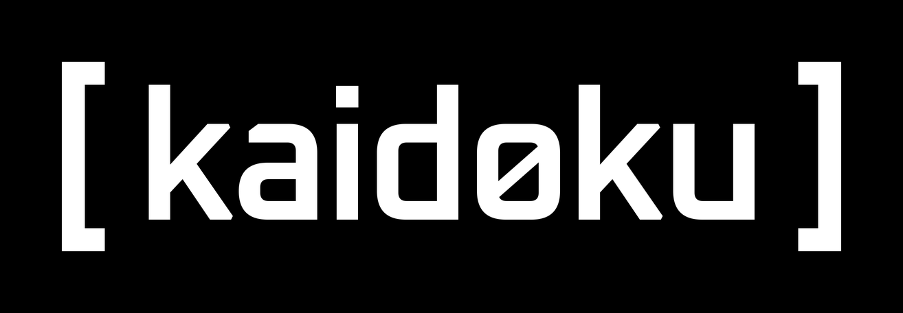

<p align="center">
  <picture>
    <source media="(prefers-color-scheme: dark)" srcset="https://raw.githubusercontent.com/0x41io/kaidoku/main/assets/kaidoku-dark.png">
    <source media="(prefers-color-scheme: light)" srcset="https://raw.githubusercontent.com/0x41io/kaidoku/main/assets/kaidoku-light.png">
    
  </picture>
</p>

**kaidoku** by 0x41: **findings and CVEs, explained.**

*Kaidoku (解読) is Japanese for "decipher".* Give it a CVE ID and it pulls the official data, tells you how urgent it really is, and (optionally) has Claude explain it in plain English: what it is, how an attack works, who's affected, and what to do. Give it [akashi](https://github.com/0x41io/akashi)'s proof history and it explains every finding akashi proved: what was found, the proof, the fix, and whether the fix worked.

**The 0x41 suite:** [mønømi](https://github.com/0x41io/monomi) finds · [akashi](https://github.com/0x41io/akashi) proves · **kaidoku explains**.

Most CVE pages give you a wall of text and a CVSS number. kaidoku combines the three signals security teams actually use to prioritize:

| Signal | Question it answers | Source |
|---|---|---|
| **CISA KEV** | Is it being exploited in the wild right now? | [CISA](https://www.cisa.gov/known-exploited-vulnerabilities-catalog), cached 24h |
| **EPSS** | How likely is exploitation in the next 30 days? | [FIRST.org](https://www.first.org/epss/) |
| **CVSS** | How bad would it be if exploited? | [NVD](https://nvd.nist.gov/) |

---

## Features

- **CVE summary card:** severity, exploitation likelihood, known-exploited status, weakness type, affected products and versions, and the most useful reference links (patches and advisories first)
- **CVSS 3.1 and 4.0 side by side:** when a CVE has both, the card shows both, so it matches what vendors and advisories quote; the verdict and ranking stay on 3.1 so scores compare fairly across CVEs. v4.0 vectors get the same plain-English attack table as v3
- **Urgency verdict without AI:** `PATCH NOW` / `HIGH PRIORITY` / `SCHEDULE` / `ROUTINE`, based on KEV first, then EPSS, then CVSS
- **Attack vector in plain English:** `AV:N/AC:L/PR:N` becomes "Network (remote) · Low complexity · No privileges needed", with the dangerous parts highlighted
- **AI briefing (optional, `--ai`):** Claude explains what it is, how an attack works (conceptually, never exploit code), who's affected, how urgent it is, what to do, and the business impact
- **Environment profiles:** describe what you run once, and kaidoku flags CVEs that hit your software (`IN YOUR STACK`), ranks them first in a batch, and tailors AI briefings to your setup. The matching works without AI. `--context` still overrides the description for a single run
- **Ransomware flag:** shows whether CISA knows a CVE is being used in ransomware campaigns, and ranks those first in a batch
- **Time to exploitation (v0.9):** for KEV CVEs, how many days passed between the NVD publishing the CVE and CISA confirming it's exploited. A negative number means CISA confirmed exploitation before the NVD record existed (a zero-day, or just a slow NVD: check the vendor's advisory date). Shown on the card, in `--json` (`kev.days_after_published`) and in AI briefings
- **What an attack needs (v0.10):** every CVE gets precondition tags, each with its reason: **DoS** (only takes the service down), **MITM** (the attacker must sit in the middle), **auth** (needs an account), **user** (someone has to click or open something), **local** / **adj** (must be on the machine or the same network), **config** (only with a certain setup). They come from the CVSS vector (3.1 and 4.0), plus a small curated list for CVEs whose vector doesn't show it (e.g. nginx's resolver bug needs forged DNS answers). Shown on the card (**Needs**), as a **Needs** column in batch tables, in `--json` (`preconditions`) and in AI briefings
- **Bug bounty exclusions (`--exclusions FILE`):** list the classes a program won't take, one per line (`dos`, `mitm`, `auth`, `user_action`, `local`, `adjacent`, `config`), and CVEs that fall under them are marked **likely not reportable here** (`*` in the table, `excluded_by` in `--json`). Never hidden, and the defender verdict doesn't change
- **"Are we affected?" prompt for a coding agent (`--agent-prompt [FILE]`):** writes a prompt you paste into Claude Code, Codex or another agent running in your repository. It's told to stay read-only (no edits, installs, builds or network), to check lockfiles first for exact versions, to treat the CVE data as untrusted (it sits in a marked block that text inside it can't close), and to answer in one fixed JSON shape: `affected` yes / no / unknown, with file, line, package and version as evidence
- **Batch triage:** feed it a list, a scanner export, or piped input, and get a ranked table, most urgent first (KEV, then EPSS, then CVSS)
- **Reads CVEs from any text:** Nessus/OpenVAS/Trivy exports, CSVs, emails, advisories. If a CVE ID is in there, kaidoku finds it
- **Reads [mønømi](https://github.com/0x41io/monomi) scans (`--monomi FILE`):** feed it monomi's `--json` output and every CVE keeps the host and IP it was found on. The card gets a **Found on** line, batch tables get a **Found on** column, and AI briefings name the affected hosts and suggest verifying each one. CDN edge IPs are skipped, same as in monomi
- **Saved briefings** in `reports/` (always next to kaidoku.py, wherever you run it from), and **JSON export** (always a list, even for one CVE)
- **Treats outside data as untrusted:** text from the NVD, CISA and Shodan is stripped of terminal escape codes before printing, and the AI is told to ignore any instructions hidden in it
- **Explains akashi's proven findings (`--akashi FILE`):** reads akashi's proof history and gives every lead a card: its state (**CONFIRMED**, **UNCLEAR**, **FIXED**, **RULED OUT**), its history (confirmed → still open → fixed), the proof akashi recorded, the exact fix and who owns it, and for an unclear lead the next step that would settle it. Ranked most urgent first. Works without AI. With `--ai`, Claude writes a briefing that must cite akashi's evidence and is told the verdict is final: it explains akashi's verdict, it never changes it
- No API keys needed for lookups

## Installation

Requires Python 3.10+.

```bash
git clone https://github.com/0x41io/kaidoku.git
cd kaidoku
python3 -m venv venv
source venv/bin/activate        # Windows: venv\Scripts\activate
pip install -e .
```

`pip install -e .` installs kaidoku with its dependencies and puts a `kaidoku`
command on your PATH, so `kaidoku CVE-2021-44228` works from any folder.
`python kaidoku.py CVE-2021-44228` from the clone works too.

**Where it keeps data:** saved briefings (`reports/`) and the CISA KEV cache
(`cache/`) live in the clone when you run it from one. A plain `pip install`
(no clone) uses `~/.kaidoku` instead, and `KAIDOKU_HOME` overrides both.

### As a library (v0.8)

The 0x41 pipeline calls kaidoku directly. Both functions are quiet (they print
nothing and write no files) and return the same data as `--json`:

```python
from kaidoku import api

out = api.explain_history("../akashi/history/example.com.jsonl", ai=True)
out = api.lookup_cves(["CVE-2021-44228"], ai=True)
```

What they return is locked by `tests/test_api.py`, so a change that would break
the pipeline fails a test first.

### API keys (both optional)

**Claude** (only for `--ai`): get a key at [console.anthropic.com](https://console.anthropic.com).

```bash
export ANTHROPIC_API_KEY="your-key-here"
export CLAUDE_MODEL="model-id-here"   # optional; defaults to the newest Sonnet
```

**NVD** (only if you look up a lot of CVEs): without a key the NVD allows about 5 lookups per 30 seconds. A [free NVD key](https://nvd.nist.gov/developers/request-an-api-key) raises that to 50. kaidoku paces its lookups to stay under either limit.

```bash
export NVD_API_KEY="your-key-here"
```

Never commit your keys. kaidoku reads them from the environment only.

## Usage

```bash
# Summary card + urgency verdict (no keys needed)
python kaidoku.py CVE-2021-44228

# Add a plain-English AI briefing (saved to reports/)
python kaidoku.py CVE-2021-44228 --ai

# Tailor the briefing to your environment
python kaidoku.py CVE-2021-44228 --ai --context "Small business, Java web apps on Tomcat, internet-facing"

# Several CVEs, saved as JSON
python kaidoku.py CVE-2024-3400 CVE-2023-4966 --json results.json

# Triage every CVE in a scanner export or any text file
python kaidoku.py --file scan-export.csv

# Pipe CVEs in from another tool
cat cves.txt | python kaidoku.py -

# Batch, but show the full card for each CVE too
python kaidoku.py --file scan-export.csv --cards

# Bug bounty: what does each CVE need, and which won't this program take?
# exclusions.txt has one class per line, e.g. "dos" and "mitm"
python kaidoku.py --monomi scan.json --exclusions exclusions.txt

# Ask a coding agent in your repo whether you're affected (saved to reports/)
python kaidoku.py CVE-2024-3400 CVE-2023-4966 --agent-prompt

# Plain output (also honors NO_COLOR)
python kaidoku.py CVE-2021-44228 --no-color
```
### From monomi (0x41 pipeline)

Run a recon scan with [mønømi](https://github.com/0x41io/monomi), then triage what it found, with each CVE tied to the server it's on:

```bash
# in the monomi folder: recon + Shodan ports/CVEs, saved as JSON
python monomi.py example.com --ports --json scan.json

# in the kaidoku folder: triage those CVEs with their locations
python kaidoku.py --monomi ../monomi/scan.json
python kaidoku.py --monomi ../monomi/scan.json --ai    # one briefing per CVE
```

monomi's CVEs come from Shodan InternetDB, which matches them from software version banners. A **Found on** host means "this server's banner matches a vulnerable version", not confirmed exploitability. Verify the installed version on each host.

### From akashi (prove, fix, re-check, explained)

[akashi](https://github.com/0x41io/akashi) proves monomi's leads and records every verdict in a proof history, one file per target. Point kaidoku at that file:

```bash
# in the akashi folder: prove the leads, apply the fixes, re-check
akashi verify scan.json --scope scope.txt
akashi recheck scan.json --scope scope.txt

# in the kaidoku folder: explain every finding
python kaidoku.py --akashi ../akashi/history/example.com.jsonl
python kaidoku.py --akashi ../akashi/history/example.com.jsonl --ai    # one briefing per finding
```

kaidoku only reads the file: it never imports akashi or runs a check, and it never changes a verdict. The state, history, fix and next step all come from akashi's records; the AI only explains them. `--akashi` runs on its own (look up CVEs in a separate run), and `--json` saves the findings as a list.

### Environment profile

Tell kaidoku what you run once, and every lookup checks the CVE against it.

```bash
mkdir -p ~/.kaidoku
cp profile.example.json ~/.kaidoku/profile.json
nano ~/.kaidoku/profile.json
```

```json
{
  "name": "acme-prod",
  "description": "Small business. Internet-facing Java web apps on Tomcat behind nginx.",
  "software": ["apache tomcat", "apache log4j", "nginx", "fortinet fortios"]
}
```

- **`software`**: product names as the NVD writes them (vendor + product, like `apache tomcat`). Shorter works too: `tomcat` matches `apache tomcat`. Matching is by whole words, so `java` won't match `javascript`.
- **`description`**: your setup in plain English. `--ai` uses it to tailor the briefing.

kaidoku loads `~/.kaidoku/profile.json` automatically if it exists. Use a different file with `--profile FILE`.

With a profile, the card gets a **Your stack** line and batch tables get a **Stack** column:

| Card | Table | Meaning |
|---|---|---|
| `IN YOUR STACK` | `YES` | an affected product matches your list |
| `not listed` | `-` | nothing in your list matches |
| `unknown` | `?` | the NVD hasn't listed affected products yet |

In a batch, in-stack CVEs rank first *within* each urgency level, so a PATCH NOW you don't run still outranks a SCHEDULE you do.

Your profile lives in your home folder, not the repo, because it describes what you run and what's exposed. Keep it private.
### Example card

```
  CVE-2021-44228  ·  Apache Log4j2 Remote Code Execution Vulnerability
  ────────────────────────────────────────────────────────────
  [ PATCH NOW ]  Actively exploited in the wild (on CISA's KEV list since 2021-12-10).

  CVSS 3.1      10.0  CRITICAL  ██████████
  EPSS          94.4% chance of exploitation in the next 30 days (top 0.1% of all CVEs)
  CISA KEV      YES · listed 2021-12-10, the same day it was published · US federal deadline 2021-12-24
  Weakness      CWE-20, CWE-400, CWE-502, CWE-917

  How it can be attacked
    Attack vector           Network (remote)
    Attack complexity       Low
    Privileges needed       None
    User interaction        None
    ...
```

## How it works

```
CVE ID ──► NVD API ───────► CVSS, KEV status, CWE, products, references ─┐
       └─► FIRST EPSS API ─► exploitation probability ────────────────────┤
                                                                          ├─► urgency verdict ─► summary card
                                                                          └─► Claude (--ai) ───► briefing + reports/
```

## Project structure

```
kaidoku/                    the repo
├── kaidoku.py              # runs the command line from a clone (python kaidoku.py ...)
├── pyproject.toml          # pip install -e . (the kaidoku command)
├── kaidoku/                # the package
│   ├── cli.py              # the command line
│   ├── api.py              # what the 0x41 pipeline calls (quiet, returns data)
│   ├── home.py             # where reports/ and cache/ live (KAIDOKU_HOME)
│   ├── triage.py           # rule-based urgency verdict (KEV > EPSS > CVSS)
│   ├── preconditions.py    # what an attack needs (DoS, MITM, auth...) + --exclusions
│   ├── agent_prompt.py     # --agent-prompt: "are we affected?" for a coding agent
│   ├── analysis.py         # Claude briefings (CVEs and akashi findings)
│   ├── monomi_import.py    # reads monomi --json (CVEs + where they were found)
│   ├── akashi_import.py    # reads akashi's proof history (findings, states, timelines)
│   ├── envprofile.py       # environment profile + stack matching
│   ├── ui.py               # banner, summary card, report rendering
│   └── sources/
│       ├── nvd.py          # NVD API 2.0 (+ CISA KEV fields)
│       ├── epss.py         # FIRST EPSS API
│       └── kev.py          # CISA KEV catalog (ransomware flag, 24h cache)
├── tests/                  # python3 -m pytest (no test may reach the network)
│   └── fixtures/           # real akashi output the tests read
├── reports/                # saved briefings (git-ignored)
├── cache/                  # local copy of the CISA KEV catalog (git-ignored)
├── profile.example.json    # example environment profile
└── requirements.txt
```
## Development

Run the tests (no internet or API keys needed; a test that tries to reach the network fails):

```bash
pip install -e . pytest
python3 -m pytest -v
```

## Limitations

- Stack matching is by product name only, without version checks. `IN YOUR STACK` means you run that software, not that your version is vulnerable. Confirm the installed version against the affected ranges.
- `--monomi` locations come from Shodan's banner-based CVE matching, which can't see distro backports or configuration. Treat **Found on** as "worth checking", not "confirmed vulnerable".
- New CVEs are often "Awaiting Analysis" in the NVD, with no CVSS score or product list yet.
- EPSS scores update daily and aren't available for every CVE.
- `--akashi` explains what akashi recorded and nothing more: an UNCLEAR finding stays unclear until a re-check settles it.
- AI briefings are only as good as the public data. Always confirm fixed versions in the vendor's advisory.

## Roadmap

- [x] Batch triage from scanner exports, files, or piped input
- [x] Ransomware-campaign flag from the CISA KEV feed
- [ ] CVE.org fallback for brand-new CVEs NVD hasn't analyzed yet
- [x] CVSS v4 vector explanations, and both scores shown when a CVE has 3.1 and 4.0 (v0.7.1)
- [x] Environment profiles saved to a file instead of `--context` every time
- [x] Read monomi scan results (`--monomi`), keeping each CVE's host and IP
- [x] v0.7: explain akashi's proven findings (`--akashi`): cards, timelines, fixes, next steps, AI briefings that cite the proof
- [x] v0.7.1: CVSS 3.1 and 4.0 side by side, v4.0 attack tables, white and grey AI briefings (red only on warnings)
- [x] v0.8: an installable package (`pip install -e .`, the `kaidoku` command) with a quiet library API for the 0x41 pipeline
- [x] v0.9: days from publication to CISA-confirmed exploitation on KEV CVEs
- [x] v0.10: precondition tags (DoS, MITM, auth, user, local, adjacent, config) from the CVSS vector plus a curated list, `--exclusions` for bug bounty program rules (marked, never hidden), and `--agent-prompt` for a read-only "are we affected?" check by a coding agent
- [ ] Read the coding agent's answer back (`--agent-answer`), then re-check after the fix
- [ ] Version-aware stack matching (reading lockfiles for exact versions)
- [ ] Web UI with PDF report export

## License

MIT. See [LICENSE](LICENSE).

---

Built by **0x41**. See also [mønømi](https://github.com/0x41io/monomi), passive domain recon with AI analysis.
